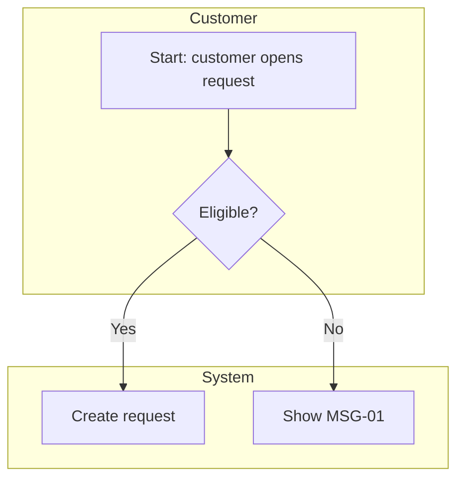
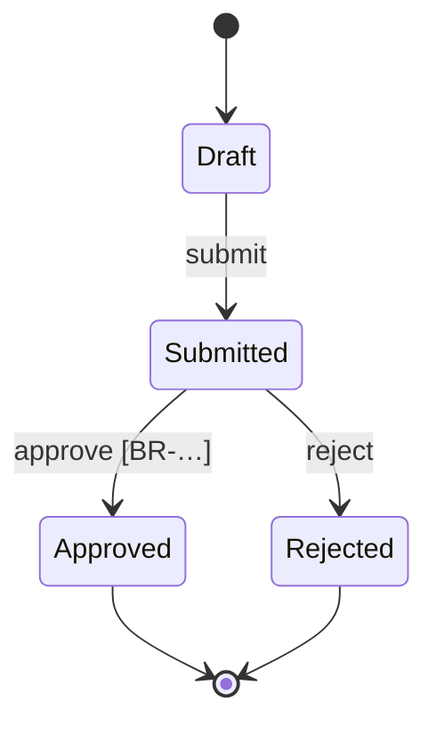
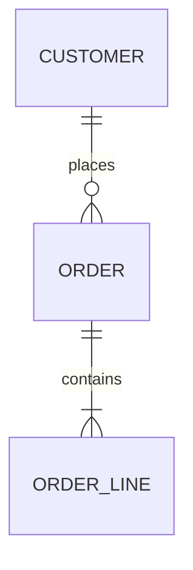

# 04 · Model — <Feature name>

## 1. Process flows

### 1.1 <Scenario name> (to-be)

| Step | Actor | Action | Rules | Notes |
|------|-------|--------|-------|-------|

## 2. State machines

### 2.1 <Entity>

| From | To | Trigger | Who | Guard (BR-) |
|------|----|---------|-----|-------------|

## 3. Domain model

| Entity | Description | Key attributes | Owner system |
|--------|-------------|----------------|--------------|

## 4. Roles & permissions
| Action \ Role | <Role A> | <Role B> | <Admin> |
|---------------|----------|----------|---------|
| View … | Allow | Own only | Allow |
| Approve … | Deny | Approval needed (> €500) | Allow |

## 5. Feature glossary
| Term | Definition | Synonyms | Don't say |
|------|------------|----------|-----------|

## 6. Questions raised by modelling
- Q-… 
