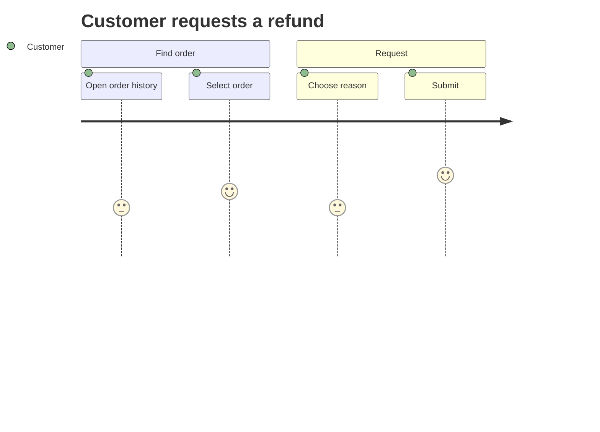
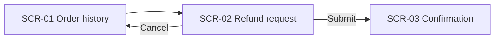

# 06 · UI/UX — <Feature name>

**Applicability:** Full · Partial (stories: US-…) · N/A (reason)

## UX inputs
| Item | Value | Source / A- / Q- |
|------|-------|------------------|
| Channels & devices | | |
| Minimum screen width | | |
| Design system / brand | | |
| Accessibility target | WCAG 2.2 AA (proposed) | A-… |
| Languages / locales | | |
| Who designs further | | |

## 1. User journeys
### <Role> — <goal>

Pain points removed: … (from 01-intake)

## 2. Screen inventory
| ID | Screen | Purpose | Roles | Entry points | Stories / AC | New / changed |
|----|--------|---------|-------|--------------|--------------|---------------|

## 3. Navigation map


## 4. Screens

### SCR-01 · <Screen name>
**Purpose:** … · **Roles:** … · **Stories:** US-…

```text
+--------------------------------------------------+
| Logo            Order history          [Profile] |
+--------------------------------------------------+
| Search [______________]  Status ▼   [Search]     |
|--------------------------------------------------|
| Order #   | Date       | Total   | Action         |
| 10023     | 2026-09-14 | €49.99  | [Request refund]|
+--------------------------------------------------+
```

| Element | Type | Data field | Behaviour | Visible / enabled for | Validation | Message |
|---------|------|-----------|-----------|----------------------|-----------|---------|

| State | What the user sees |
|-------|-------------------|
| Default | |
| Empty | |
| Loading | |
| Validation error | |
| System error | |
| Success | |
| Permission-limited | |

**Microcopy:** heading "…", helper "…", buttons "…"
**Responsive:** …
**Accessibility:** focus order …, keyboard …, labels …

## 5. Heuristics check
| Screen | Heuristic | Finding | Action |
|--------|-----------|---------|--------|

## 6. Coverage
| Story / AC | Screen / element |
|-----------|------------------|

**Uncovered:** none / list

## 7. Design decisions & feedback
| D- | Decision | By | Date |
|----|----------|----|------|
