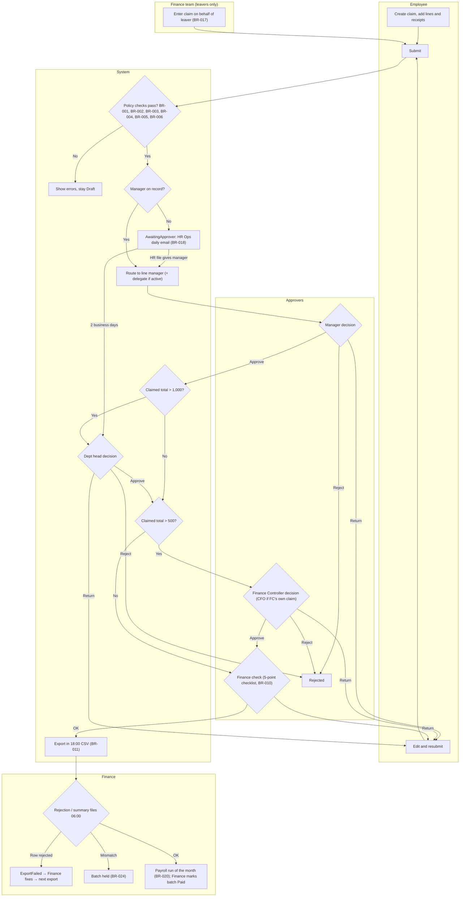
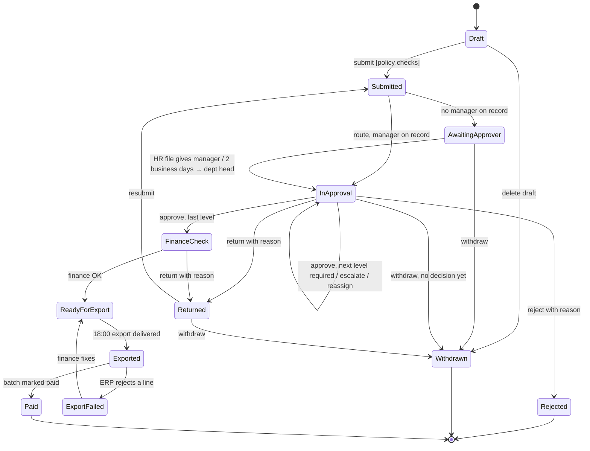
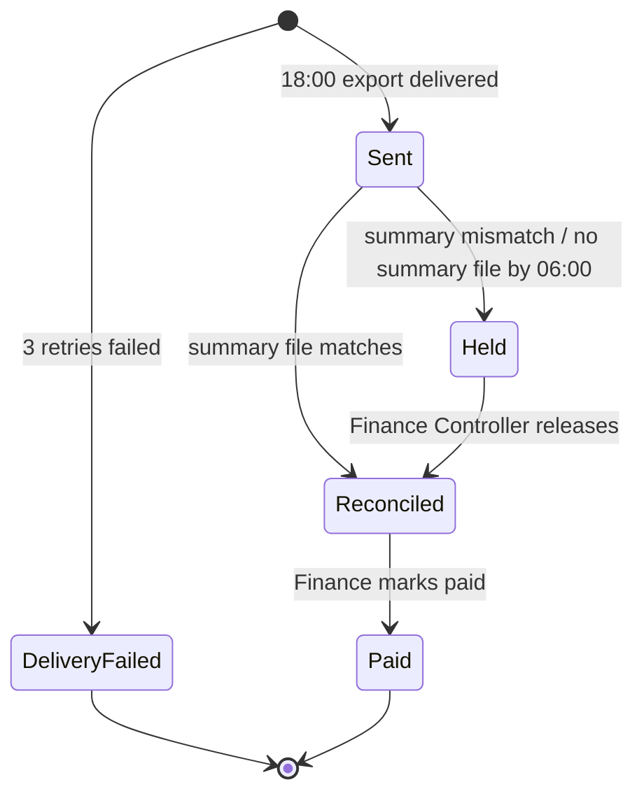
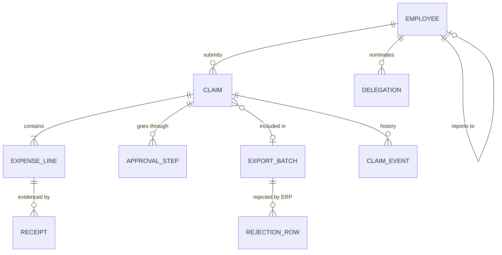
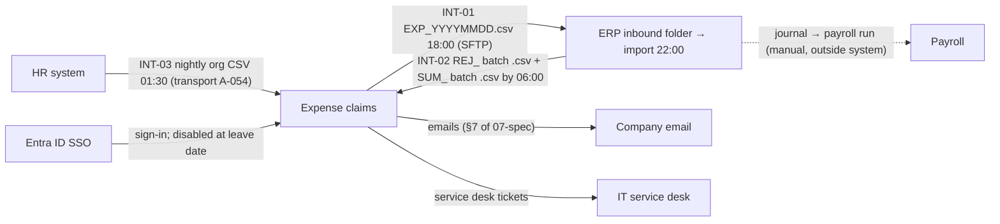
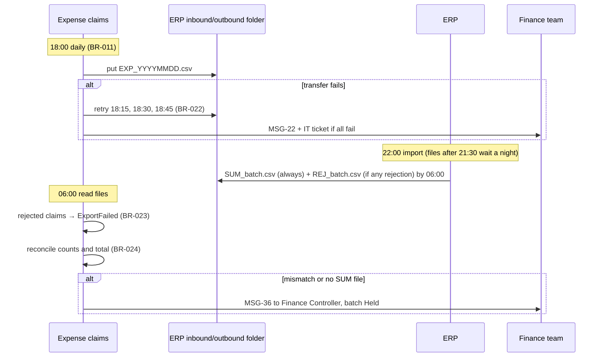

# 04 · Model — Expense claims & approvals

> Updated 2026-10-26 after round-2 answers (SRC-06, SRC-07): no-manager wait state, fallback approvers,
> escalation powers, on-behalf claims, reconciliation hold, integration context and sequence diagrams.

## 1. Process flow — submit to payment (to-be)



| Step | Actor | Action | Rules | Notes |
|------|-------|--------|-------|-------|
| 1 | Employee | Create claim, add lines, attach receipts | BR-001, BR-002, BR-003, BR-004, BR-005, BR-006, BR-012 | Phone camera upload (D-004) |
| 1b | Finance team | Enter a claim on behalf of a leaver after the leave date | BR-017 | D-021 |
| 2 | System | Validate on submit | BR-001, BR-002, BR-003, BR-004, BR-005, BR-006 | Errors block submit |
| 3 | System | Route to manager (and delegate if active); if no manager → wait | BR-007, BR-008, BR-018 | Manager from HR file (D-039) |
| 4 | Manager / delegate / escalation target | Approve / return / reject | BR-009, BR-013, BR-015 | Return restarts at manager (D-007) |
| 5 | Dept head | Approve / return / reject if claimed total > €1,000 | BR-007, BR-019 | D-003, D-032 |
| 6 | Finance Controller (CFO for FC's own claim) | Approve / return / reject if claimed total > €500 | BR-007, BR-019 | SRC-03 §5.2, D-033 |
| 7 | Finance team | Check against the 5-point checklist; mark OK or return | BR-010, BR-021 | D-029, D-030 |
| 8 | System | Export ready claims at 18:00 daily; retry 3 × 15 min | BR-011, BR-022 | D-013, D-038 |
| 9 | System | Read rejection and summary files by 06:00 | BR-023, BR-024 | D-038 |
| 10 | Finance team | Mark batch paid after the payroll run of the batch's payroll month | BR-020 | D-019, D-028 |

## 2. State machine — Claim



`Submitted` is transient: routing happens in the same transaction as submission (the claimant sees
*InApproval* or *AwaitingApprover* straight away — AC-001.1).

| From | To | Trigger | Who | Guard | SLA effect | Notify |
|------|----|---------|-----|-------|-----------|--------|
| Draft | Submitted | Submit | Employee, or Finance team for a leaver (BR-017) | BR-001, BR-002, BR-003, BR-004, BR-005, BR-006 | — | — |
| Draft | Withdrawn | Delete draft | Employee / entering Finance member | Never submitted | — | — |
| Submitted | InApproval | Route | System | BR-007, BR-008, manager on record | Start level clock | None — inbox; digest from day 3 (BR-015) |
| Submitted | AwaitingApprover | Route | System | No manager in latest HR file (BR-018) | Start 2-business-day hold clock | HR Ops daily email MSG-31 |
| AwaitingApprover | InApproval | HR file provides manager, or 2 business days elapse | System | BR-018 | Start level clock | None — inbox and digest (A-069) |
| AwaitingApprover | Withdrawn | Withdraw | Employee | — | Stop | — |
| InApproval | InApproval | Approve (more levels) | Approver | BR-007, BR-009, BR-019 | Restart clock for next level (A-046) | None — next approver sees it in inbox and digest (A-069) |
| InApproval | InApproval | Escalate (day 5) | System | BR-015 | No restart; escalation target added | MSG-21 |
| InApproval | InApproval | Reassign | Finance Controller | BR-025, reason mandatory | Restart clock | New approver MSG-32 |
| InApproval | FinanceCheck | Approve (last level) | Approver | BR-009 | Stop level clock; start Finance-check clock (BR-021) | — (Finance queue) |
| InApproval | Returned | Return | Approver | BR-013 | Stop | Claimant MSG-46 (A-069) |
| InApproval | Rejected | Reject | Approver | BR-013 | Stop | Claimant MSG-47 (A-069) |
| InApproval | Withdrawn | Withdraw | Employee | No decision recorded yet (A-035) | Stop | None — leaves the inbox (A-069) |
| FinanceCheck | ReadyForExport | Mark OK | Finance team | BR-009, BR-010 | Stop | — |
| FinanceCheck | Returned | Return | Finance team | BR-013 | Stop | Claimant MSG-46 (A-069) |
| Returned | Submitted | Resubmit | Employee | BR-001 (date of first submission, D-031), BR-014 | — | — |
| Returned | Withdrawn | Withdraw | Employee | — | — | — |
| ReadyForExport | Exported | Daily export delivered | System | BR-011, BR-022 | — | — |
| Exported | ExportFailed | Rejection file lists the claim | System | BR-023 | — | Finance MSG-25 |
| ExportFailed | ReadyForExport | Fix and mark ready | Finance team | — | — | — |
| Exported | Paid | Mark batch paid | Finance team | BR-020, batch not held (BR-024) | — | Claimant MSG-23 |

### Invalid transitions (must be refused)
| Attempt | State | Result |
|---------|-------|--------|
| Approve / return / reject | Withdrawn, Rejected, Returned, FinanceCheck or later | Refused with MSG-33 "This claim is no longer waiting for you." |
| Decide after another approver decided at the same level | InApproval (next level) or later | Refused with MSG-34 "Already decided by {name}." |
| Withdraw | After the first decision (FinanceCheck, ReadyForExport, Exported, ExportFailed, Paid, or InApproval with a decision) | Refused with MSG-29 |
| Mark paid | Batch held | Refused with MSG-35 |
| Edit lines | Any state except Draft and Returned | Not offered (read-only) |

## 3. State machine — Export batch



| From | To | Trigger | Who | Guard | Notify |
|------|----|---------|-----|-------|--------|
| — | Sent | Transfer succeeds | System | BR-011, BR-022 | — |
| — | DeliveryFailed | 18:45 retry fails | System | BR-022 | Finance MSG-22; IT ticket |
| Sent | Reconciled | `SUM_` file matches (BR-024) | System | — | — |
| Sent | Held | Mismatch or missing `SUM_` file at 06:00 | System | BR-024 | Finance Controller MSG-36 |
| Held | Reconciled | Release with reason | Finance Controller | Reason 5–500 chars (A-034) | — |
| Reconciled | Paid | Mark paid | Finance team | BR-020 | Claimants MSG-23 |

A *DeliveryFailed* run leaves its claims in *ReadyForExport*; they go in the next day's batch.

## 4. Domain model



| Entity | Description | Owner system / source of truth |
|--------|-------------|--------------|
| Employee | Person with manager, department head, cost centre, leave date, status | HR system (nightly file INT-03, D-039) |
| Claim | One submission | This system |
| Expense line | Date, category, amount, domestic flag, VAT number, details | This system |
| Receipt | Image/PDF evidence | This system |
| Approval step | One level of the chain and its decision | This system |
| Delegation | Approver → delegate for a date range | This system |
| Export batch | One daily CSV and its reconciliation result | This system → ERP |
| Rejection row | One line from `REJ_` file | ERP (INT-02) |
| Claim event | Status change / decision / reassignment / escalation history | This system |
| GL account per category | Mapping table (D-037) | Finance (configuration) |
| Posted journal | Lines posted in the ERP | ERP |

## 5. Integration context and sequences (integration profile)





```mermaid
sequenceDiagram
  participant HR as HR system
  participant EC as Expense claims
  participant SD as IT service desk
  participant HO as HR Ops
  HR->>EC: org file lands 01:30
  Note over EC: 02:00 import (BR-026)
  alt file missing or invalid at 02:00
    EC->>SD: open ticket; keep yesterday's data
  else valid
    EC->>EC: full refresh of employees
    EC->>EC: AwaitingApprover claims with a manager now → InApproval
    EC->>EC: new leave dates → Leaver flag (BR-016)
  end
  EC->>HO: daily MSG-31 list of claims waiting for a manager record
```

| Data | Source of truth | Copy in this system | Refresh |
|------|-----------------|---------------------|---------|
| Employee, manager, dept head, cost centre, leave date | HR system | Yes | Nightly full refresh (INT-03) |
| Posted journal lines | ERP | Rejection rows and batch totals only | Daily (INT-02) |
| Claims, receipts, approvals | This system | — | — |
| Identity | Entra ID | User id only | Each sign-in |

## 6. Roles & permissions
| Action \ Role | Employee | Manager | Delegate | Dept head | Finance Controller | CFO | Finance team | HR Ops |
|---------------|----------|---------|----------|-----------|--------------------|-----|--------------|--------|
| Create / submit own claim | Allow | Allow | Allow | Allow | Allow | Allow | Allow | Allow |
| Create claim on behalf of a leaver; edit / resubmit / withdraw it when returned (A-071) | Deny | Deny | Deny | Deny | Allow (A-068) | Deny | Allow (BR-017) | Deny |
| View claim (A-060) | Own only | Claims they are/were an approver on | Claims routed to them during the delegation | Claims they are/were an approver on | All | Claims they are/were an approver on | All | Deny (emails only) |
| Approve / return / reject (state InApproval, at own level) | Deny | Team's, not own (BR-009) | Delegated, not own, not where also a later approver (BR-008) | Department's > €1,000; fallback (BR-018) | > €500; vacant dept head (BR-019); not own | Escalations at FC level; FC's own claims (BR-019) | Deny | Deny |
| Bulk approve | Deny | Manager level, ≤ €250, no leavers (BR-027) | Same as manager | Deny | Deny | Deny | Deny | Deny |
| Nominate delegate | Deny | Allow | Deny | Allow | Allow | Allow (A-038) | Deny | Deny |
| Reassign a waiting approval step | Deny | Deny | Deny | Deny | Allow (BR-025) | Deny | Deny | Deny |
| Finance check / mark ready (state FinanceCheck) | Deny | Deny | Deny | Deny | Allow, not own claim, not a claim they approved (BR-009) | Deny | Allow, not own claim, not an on-behalf claim they entered (A-039) | Deny |
| Fix export failures (state ExportFailed) | Deny | Deny | Deny | Deny | Allow | Deny | Allow | Deny |
| Release a held batch | Deny | Deny | Deny | Deny | Allow | Deny | Deny | Deny |
| Mark batch paid | Deny | Deny | Deny | Deny | Allow | Deny | Allow | Deny |
| Finance list & CSV export | Deny | Deny | Deny | Deny | Allow | Deny | Allow | Deny |
| Receive no-manager list (MSG-31) | — | — | — | — | — | — | — | Receives |
| Set leave date / manager | Deny | Deny | Deny | Deny | Deny | Deny | Deny | In HR system (A-002) |

## 7. Feature glossary
| Term | Definition | Don't say |
|------|------------|-----------|
| Claim | One submission containing one or more expense lines | "Expense" for the whole claim |
| Claimed total | Sum of line amounts as entered; drives approval thresholds (D-032) | "Total" without qualifier |
| Reimbursable total | Sum after caps; the amount paid and exported | — |
| Return | Send back to the claimant for changes; approval restarts at manager | "Reject" (final) |
| Reject | Final refusal; claim closed | — |
| Domestic | Expense incurred in France (SRC-06) | "Local" |
| On-behalf claim | Claim entered by Finance for a leaver after their leave date (D-021) | "Proxy claim" |
| Escalation target | The approver's manager in the HR file; CFO at Finance Controller level (D-026) | "Supervisor" |
| Payroll month | Month whose payroll pays a batch: the export month if exported by the 20th 18:00, else the next (D-028) | — |

## 8. Questions raised by modelling
- Q-015, Q-016, Q-017 — answered (D-018, D-019, D-020).
- Q-037: manager change in the HR file while a claim waits (A-041).
