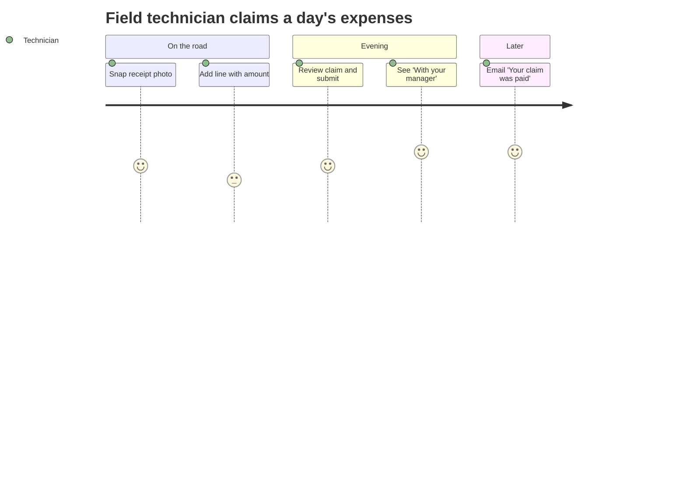
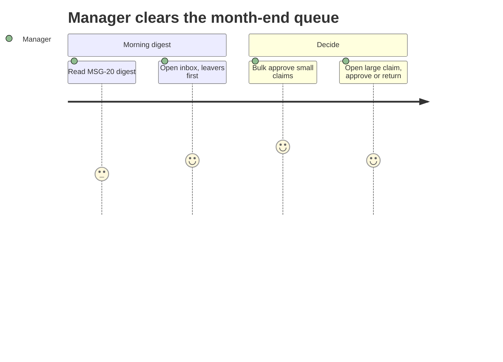
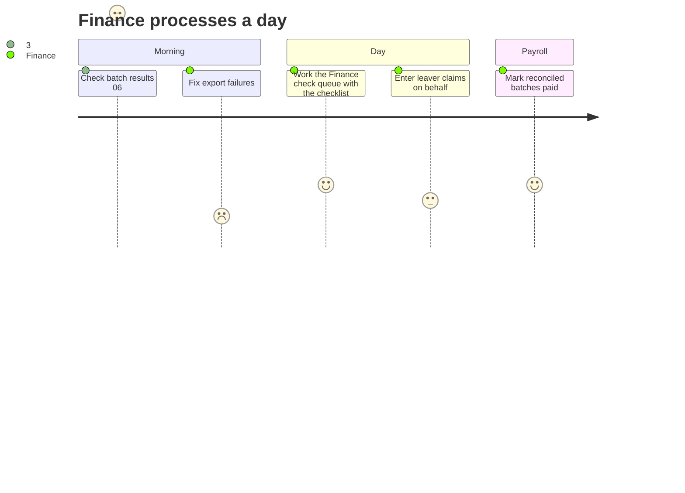
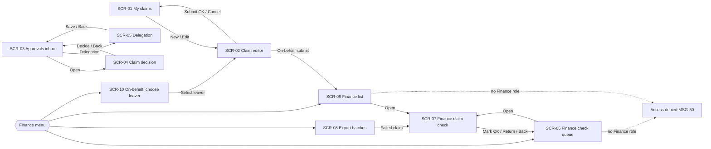

# 06 · UI/UX — Expense claims & approvals

**Applicability:** Applicable — **full run** (2026-10-26). The Lite override O-01 is **removed** by D-040
(pilot-BA, simulated): the review rated the Lite run Critical (review #7). All screens any story needs are
designed below, including the Finance screens. HR Ops and IT have no screens (emails and tickets only, 07-spec §7).

## UX inputs
| Item | Value | Source / A- / Q- |
|------|-------|------------------|
| Channels & devices | Desktop browser for all roles; phone browser for claimants (camera upload) | D-004 |
| Minimum screen width | 360 px | A-009 |
| Design system / brand | Company intranet UI kit | A-010 |
| Accessibility target | WCAG 2.2 AA | A-011 |
| Languages | English only (MVP) | A-012 |
| Who designs further | In-house designer refines; AI coding agent builds from these wireframes | `_status.md` (Builders) |
| Prototype | Not produced this round (BA choice, simulated) — wireframes below are the reference | D-040 |

## 1. User journeys



Pain points removed (01-intake): lost emails and no status (SCR-01, SCR-03), re-keying (SCR-08 export),
returns for missing information (SCR-02 checks), leavers found too late (leaver flag, SCR-10).

## 2. Screen inventory
| ID | Screen | Purpose | Roles | Entry points | Stories / AC | New |
|----|--------|---------|-------|--------------|--------------|-----|
| SCR-01 | My claims | List own claims with status; withdraw | All employees | Home, MSG-23 link | US-012, AC-001.4 | New |
| SCR-02 | Claim editor | Create/edit lines, receipts, submit; on-behalf mode | Claimant; Finance team (on-behalf) | SCR-01 New/Edit, SCR-10 | US-001, US-002, US-014 | New |
| SCR-03 | Approvals inbox | Claims waiting for me; bulk approve | Manager, delegate, escalation target, dept head, Finance Controller, CFO | Home, MSG-20/21/32 links | US-004, US-006, US-011, US-005 | New |
| SCR-04 | Claim decision | Read claim, history; approve / return / reject | Same as SCR-03 | SCR-03 row | US-004, US-005, US-006 | New |
| SCR-05 | Delegation settings | Nominate / end a delegation | Manager, dept head, Finance Controller, CFO (A-038) | SCR-03 header | US-005 | New |
| SCR-06 | Finance check queue | FinanceCheck claims | Finance team, Finance Controller | Finance menu, MSG-40 link | US-007 | New |
| SCR-07 | Finance claim check | Checklist, mark OK / return; edit cost centre; FC: reassign | Finance team, Finance Controller | SCR-06 row, SCR-08 failed claim, SCR-09 row | US-007, US-010, US-016 | New |
| SCR-08 | Export batches | Batch list and detail: delivery, rejections, reconciliation, release, mark paid | Finance team; release: Finance Controller | Finance menu, MSG-22/25/36 links | US-008, US-009, US-010, US-019 | New |
| SCR-09 | Finance list | Filter all claims, G-01 summary, CSV export | Finance team, Finance Controller | Finance menu | US-013, US-016, US-011 | New |
| SCR-10 | On-behalf claim — choose leaver | Find an employee whose leave date has passed | Finance team, Finance Controller | Finance menu | US-014 | New |

## 3. Navigation map


## 4. Screens

### SCR-01 · My claims
```text
+----------------------------------------------------------+
| My claims                                   [+ New claim] |
|----------------------------------------------------------|
| C-1021  Draft          €42.00   Updated 2026-11-04 [Edit]|
| C-1011  With M. Rossi  €116.50  Updated 2026-11-03 [⋯]   |
| C-1015  Returned: "Add hotel receipt"  €210.00   [Edit]  |
| C-1001  Paid 2026-11-27  €116.50                         |
|----------------------------------------------------------|
| ⋯ menu: [Withdraw]  (only before the first decision)     |
+----------------------------------------------------------+
```
| Element | Type | Data field | Behaviour | Visible / enabled | Validation | Message |
|---------|------|-----------|-----------|-------------------|-----------|---------|
| Claim row | list item | claim_id, status, current approver, total_reimbursable, last update | Opens read-only view or SCR-02 for Draft/Returned | Own claims only (NFR-05) | — | — |
| Status text | text | status + current approver | "With {name}", "Waiting for a manager record" (AwaitingApprover), "Returned: {reason}" | Always | — | — |
| New claim | button | — | Opens SCR-02 | Always | — | — |
| Withdraw | menu action | — | Confirm dialog → Withdrawn | Draft, AwaitingApprover, InApproval without decision, Returned | A-035 | MSG-29 if refused |

| State | What the user sees |
|-------|-------------------|
| Default | Claims newest first, status in words (not colour only) |
| Empty | "You have no claims yet." + [+ New claim] |
| Loading | Skeleton rows; header and New claim usable |
| Validation error | n/a (no input) — withdraw refusal shows MSG-29 in a banner |
| System error | "We couldn't load your claims. [Try again]" |
| Success | After submit: banner "Claim submitted — with {manager}" or "— waiting for a manager record"; after withdraw: "Claim withdrawn" |
| Permission-limited | Only own claims; another person's claim URL shows MSG-30 |
| Read-only | Submitted or later claims open read-only with status history |

### SCR-02 · Claim editor
```text
+--------------------------------------------------+
| < My claims          New claim        [Save draft]|
| (on-behalf mode: "Entered for Anna B. (left       |
|  2026-12-15) by F10 — lines up to 2026-12-15")    |
|--------------------------------------------------|
| Line 1  Date [2026-11-03]  Category [Meals ▼]     |
|         Trip (•) Domestic ( ) Abroad  (required)  |
|         Amount € [32.50]  Description [_______]   |
|         €30.00 of €40 used on this day            |
|         Supplier VAT no. [________] (optional)    |
|         Receipt [📷 Take photo] [⬆ Upload]  ✔ img |
|         [x] Excludes alcohol/fines/personal  ⓘ    |
| Line 2  Date [__]  Category [Mileage ▼]           |
|         From [Lyon___] To [Grenoble] Km [112]     |
|         Amount € 33.60 (auto)                     |
| [+ Add line]                                      |
|--------------------------------------------------|
| Claimed €66.10 · Reimbursable €43.60 [Submit claim]|
+--------------------------------------------------+
```
| Element | Type | Data field | Behaviour | Visible / enabled | Validation | Message |
|---------|------|-----------|-----------|-------------------|-----------|---------|
| Date | date | ExpenseLine.expense_date | Max: today (on-behalf: leave date) | Always | BR-001, BR-017 | MSG-01, MSG-38 |
| Category | select | ExpenseLine.category | Mileage shows From/To/Km and hides Amount input | Always | — | — |
| Trip | radio | ExpenseLine.trip_location | No default; required (A-058) | Meals only | BR-002, BR-003 | MSG-37 |
| Amount | money | ExpenseLine.amount | 2 decimals; domestic meals show daily usage hint | Not for mileage | BR-003 | MSG-03 |
| Km / From / To | int / text | km, from, to | Amount = km × €0.30 | Mileage only | BR-004 | MSG-04 |
| Description | text | ExpenseLine.description | 3–200 chars | Always | A-033 | — |
| VAT number | text | ExpenseLine.vat_number | Optional | Always | A-049 | — |
| Receipt | camera/upload | Receipt.file | JPEG/PNG/PDF ≤ 10 MB, ≤ 5 | Always | BR-002, BR-012 | MSG-02, MSG-07 |
| Exclusions tick | checkbox | ExpenseLine.declaration | Required for meals, accommodation and other (A-059) | Meals, accommodation, other | BR-005 | MSG-05 |
| Save draft | button | — | Saves; autosave 30 s | Draft, Returned | A-019 | — |
| Submit | button | — | Runs all checks; errors listed at top and next to lines | Draft, Returned | BR-001, BR-002, BR-003, BR-004, BR-005, BR-006 | MSG-01, MSG-02, MSG-03, MSG-04, MSG-05, MSG-06, MSG-37 |
| Delete draft | link | — | Confirm → Withdrawn | Never-submitted Draft | — | — |

| State | What the user sees |
|-------|-------------------|
| Default | One empty line |
| Empty | n/a — a claim always starts with one line |
| Loading | Opening an existing draft: fields disabled with spinner |
| Upload in progress | Progress bar on the line; Submit disabled |
| Validation error | Error summary at top + inline messages; focus moves to the first error |
| System error | "We couldn't save your claim. Your draft is kept." + [Retry] |
| Success | Back to SCR-01 (claimant) or SCR-09 (on-behalf) with banner |
| Permission-limited | On-behalf mode only for Finance roles; dates after leave date refused |
| Read-only | Submitted or later: all inputs disabled, "This claim is with {approver}" |

**Responsive:** at < 600 px lines stack vertically; Submit is sticky at the bottom.
**Accessibility:** labels on every field; camera button has text; errors announced (aria-live); radio group has a legend.

### SCR-03 · Approvals inbox
```text
+----------------------------------------------------------+
| Approvals (12)        Filter [All ▼]      [Delegation ⚙] |
|----------------------------------------------------------|
| [–] ⚠ LEAVER  Anna B.  C-1015  €212.00 Mgr Waiting 4 d ⏰ |
| [ ]           Tom K.   C-1001  €116.50 Mgr Waiting 1 d   |
| [–]           Sara L.  C-1009  €640.00 Mgr Waiting 2 d   |
| [ ]  for M200 Ivo P.   C-1033  €45.00  Mgr Waiting 0 d   |
| [–] ESCALATED for M200 C-1005  €90.00  Mgr Waiting 6 d   |
|----------------------------------------------------------|
| [Approve selected (0)]   [–] = not eligible (MSG-39)     |
+----------------------------------------------------------+
```
| Element | Type | Data field | Behaviour | Visible / enabled | Validation | Message |
|---------|------|-----------|-----------|-------------------|-----------|---------|
| Row | list item | claimant, claim_id, total_claimed, level, waiting business days, badges | Opens SCR-04 | Claims at my level incl. delegated, escalated | — | — |
| Bulk checkbox | checkbox | — | Max 50 | Enabled only if BR-027 eligible | BR-027 | MSG-39 tooltip |
| Approve selected | button | — | Confirm dialog with count and total | ≥ 1 selected | BR-027 | — |
| Badges | text | acting_as | "for {name}" (delegate), "ESCALATED", "LEAVER", ⏰ "Reminder sent" | — | — | — |
| Delegation | link | — | Opens SCR-05 | Roles that may delegate | — | — |

| State | What the user sees |
|-------|-------------------|
| Default | Leavers first, then longest waiting |
| Empty | "Nothing waiting for you." |
| Loading | Skeleton rows |
| Validation error | Selecting a 51st claim: selection stays at 50, MSG-39 |
| System error | "We couldn't load your approvals. [Try again]" |
| Success | Bulk: "12 claims approved" banner; rows removed |
| Partial | Bulk where one claim changed meanwhile: "11 approved; 1 was no longer waiting (MSG-33)" |
| Permission-limited | Users with no approver role see Empty state text "You have no approvals." |
| Overdue | ⏰ "Reminder sent" from business day 3; text label "ESCALATED" from business day 5 (not colour only) |
| Bulk confirm | Dialog "Approve 12 claims totalling €1,420.10?" [Approve] [Cancel] |

### SCR-04 · Claim decision
```text
+----------------------------------------------------------+
| < Approvals   C-1009 · Sara L. · €640.00 claimed          |
| Level: Manager (you)  → then Finance Controller           |
|----------------------------------------------------------|
| 2026-11-03 Hotel Lyon   €520.00  [receipt 🖼]  VAT FR12.. |
| 2026-11-03 Meals (dom.) €45.00 → €40.00 reimbursable     |
| 2026-11-04 Train        €75.00   [receipt 🖼]             |
|----------------------------------------------------------|
| History: submitted 2026-11-05 · reminder 2026-11-10      |
|----------------------------------------------------------|
| Reason (required for return / reject) [______________]   |
| [Approve]   [Return for changes]   [Reject]              |
+----------------------------------------------------------+
```
| Element | Type | Data field | Behaviour | Visible / enabled | Validation | Message |
|---------|------|-----------|-----------|-------------------|-----------|---------|
| Header | text | claim_id, claimant, total_claimed, chain | Shows remaining levels | Always | — | — |
| Lines | table | ExpenseLine.* | Receipt opens full-size viewer | Always | — | — |
| History | list | ClaimEvent | Status changes, reminders, escalation, reassignment | Always | — | — |
| Reason | textarea | ApprovalStep.reason | 5–500 chars | Always | BR-013 | MSG-08 |
| Approve / Return / Reject | buttons | ApprovalStep.decision | Saves decision | Hidden when BR-008/BR-009 exclude the user | BR-008, BR-009 | MSG-42, MSG-33, MSG-34 |

| State | What the user sees |
|-------|-------------------|
| Default | Claim read-only with decision area |
| Empty | n/a — a claim has ≥ 1 line |
| Loading | Lines skeleton; buttons disabled |
| Validation error | Return/reject without reason: MSG-08 under the field |
| System error | "We couldn't save your decision. Nothing has changed. [Try again]" |
| Success | Back to SCR-03, banner "C-1009 approved — next: Finance Controller" |
| Permission-limited | Excluded user: buttons hidden, MSG-42 shown |
| Read-only / locked | Someone else decided: MSG-34; claim withdrawn: MSG-33 |

### SCR-05 · Delegation settings
```text
+--------------------------------------------------+
| Delegation                                        |
|--------------------------------------------------|
| Delegate   [Search employee______ ▼]              |
| From [2026-12-14]   To [2026-12-31]               |
| ⓘ Absence must be longer than 3 working days,     |
|   up to 60 days (policy 5.4)                      |
| [Save delegation]                                 |
|--------------------------------------------------|
| Active: M201 · 2026-12-14 – 2026-12-31 [End now]  |
+--------------------------------------------------+
```
| Element | Type | Data field | Behaviour | Visible / enabled | Validation | Message |
|---------|------|-----------|-----------|-------------------|-----------|---------|
| Delegate | search select | Delegation.delegate_id | Active employees only | Always | BR-008 | — |
| From / To | date | from_date, to_date | Inclusive | Always | BR-008 | MSG-09 |
| Save | button | — | Creates delegation | Fields valid | BR-008 | MSG-09 |
| End now | button | to_date | Sets to_date = today | Active delegation | — | — |

| State | What the user sees |
|-------|-------------------|
| Default | Form + current delegation if any |
| Empty | "No delegation set." |
| Loading | Form disabled with spinner |
| Validation error | MSG-09 under the dates |
| System error | "We couldn't save the delegation. [Try again]" |
| Success | "M201 will see your approvals from 2026-12-14 to 2026-12-31." |
| Permission-limited | Users with no approver role: MSG-30 |

### SCR-06 · Finance check queue
```text
+----------------------------------------------------------+
| Finance check (23)          Filter [All ▼]  [Search____] |
|----------------------------------------------------------|
| ⚠ LEAVER Anna B. C-1015 €212.00 approved 2026-11-16 2 d ⏰|
|          Tom K.  C-1001 €116.50 approved 2026-11-17 1 d   |
|          F10 (own) C-1008 €60.00  — checked by others     |
+----------------------------------------------------------+
```
| Element | Type | Data field | Behaviour | Visible / enabled | Validation | Message |
|---------|------|-----------|-----------|-------------------|-----------|---------|
| Row | list item | claimant, claim_id, total_reimbursable, approved date, waiting business days | Opens SCR-07 | FinanceCheck claims | — | — |
| Own / excluded label | text | — | "own" / "you approved" / "you entered" | When BR-009 / A-039 exclude the user | BR-009 | — |
| Overdue | icon + text | — | ⏰ "Over 2 business days" | From business day 3 (SLA exceeded) | BR-021 | — |

| State | What the user sees |
|-------|-------------------|
| Default | Leavers first, then longest waiting |
| Empty | "No claims waiting for the Finance check." |
| Loading | Skeleton rows |
| Validation error | n/a (no input besides search) |
| System error | "We couldn't load the queue. [Try again]" |
| Success | Returning from SCR-07: banner "C-1001 marked OK" |
| Permission-limited | No Finance role: MSG-30 |

### SCR-07 · Finance claim check
```text
+----------------------------------------------------------+
| < Finance check  C-1001 · Tom K. · €116.50 · CC [4100 ▼] |
|----------------------------------------------------------|
| Lines with receipts (as SCR-04)                          |
|----------------------------------------------------------|
| Checklist                                                |
| [x] 1 Itemised receipt where required (no card slips)    |
| [x] 2 Receipt amount matches the line                    |
| [ ] 3 VAT number recorded when on the receipt            |
| [x] 4 No alcohol, fines or personal items on receipt     |
| [x] 5 Cost centre valid                                  |
| Reason (for return) [______________]                     |
| [Mark OK]  [Return for changes]     FC only: [Reassign…] |
|----------------------------------------------------------|
| ERP error (ExportFailed only): "Unknown cost centre"      |
+----------------------------------------------------------+
```
| Element | Type | Data field | Behaviour | Visible / enabled | Validation | Message |
|---------|------|-----------|-----------|-------------------|-----------|---------|
| Cost centre | select | ExpenseLine.cost_centre | Editable by Finance | FinanceCheck, ExportFailed | A-017 | — |
| Checklist 1–5 | checkboxes | FinanceCheck.items_ticked | — | FinanceCheck | BR-010 | MSG-44 |
| Mark OK | button | — | → ReadyForExport; for a fixed ExportFailed claim all 5 items are ticked again and only cost centre is editable (A-076) | Not for excluded users (BR-009, A-075); fixer ≠ claimant | BR-009, BR-010 | MSG-44 |
| Return | button | — | → Returned | FinanceCheck; not excluded users | BR-013 | MSG-08 |
| Reassign… | dialog (approver search + reason) | ApprovalStep.approver_id | Undecided approval step only | Finance Controller only | BR-025, BR-013 | MSG-41, MSG-08 |
| ERP error | text | Claim.export_error | — | ExportFailed | BR-023 | — |

| State | What the user sees |
|-------|-------------------|
| Default | Claim + checklist unticked |
| Empty | n/a |
| Loading | Skeleton; actions disabled |
| Validation error | MSG-44 naming the missing item; MSG-08 for return without reason |
| System error | "We couldn't save. Nothing has changed. [Try again]" |
| Success | Back to SCR-06 with banner |
| Permission-limited | Excluded user: actions hidden, text "Another Finance team member must check this claim." |
| Read-only | ReadyForExport or later (except ExportFailed): read-only with history |
| Reassign (FC, InApproval claim opened from SCR-09) | Dialog: approver search, reason, [Reassign]; success "Reassigned to M205" |

### SCR-08 · Export batches
```text
+----------------------------------------------------------------+
| Export batches                                                  |
|----------------------------------------------------------------|
| EXP-20261118  HELD ⚠   120 lines €5,000.00  payroll 2026-11  [⋯]|
| EXP-20261117  Reconciled 118/120 (2 rejected) payroll 2026-11 [Mark paid]|
| EXP-20261116  Paid 2026-11-27  112 lines  €4,210.40            |
| EXP-20261115  DELIVERY FAILED — claims moved to next batch     |
|----------------------------------------------------------------|
| Batch detail: lines sent / posted / rejected, totals, files    |
| Failed claims: C-1010 "Unknown cost centre" [Open]             |
| FC on HELD: Reason [__________] [Release batch]                |
| Mark paid: Paid date [2026-11-27] [Confirm]                    |
+----------------------------------------------------------------+
```
| Element | Type | Data field | Behaviour | Visible / enabled | Validation | Message |
|---------|------|-----------|-----------|-------------------|-----------|---------|
| Batch row | list item | batch_id, state, lines_sent, total_sent, payroll_month | Opens detail | Finance roles | — | — |
| Failed claims | list | Claim.export_error | Opens SCR-07 | Batch has ExportFailed claims | BR-023 | — |
| Release batch | button + reason | release_reason | Held → Reconciled | Finance Controller, Held | BR-013, BR-024 | MSG-08 |
| Mark paid | button + date | paid_date | All Exported claims → Paid | Reconciled | BR-020, BR-024 | MSG-24, MSG-35 |

| State | What the user sees |
|-------|-------------------|
| Default | Newest batch first; state in words |
| Empty | "No batches yet. The first export runs at 18:00." |
| Loading | Skeleton rows |
| Validation error | MSG-24 for an invalid paid date; MSG-08 for release without reason |
| System error | "We couldn't load batches. [Try again]" |
| Success | "Batch EXP-20261117 marked paid — 37 claimants notified" |
| Permission-limited | Finance team: Release hidden; non-Finance: MSG-30 |
| Locked | Held batch: Mark paid disabled with MSG-35 |

### SCR-09 · Finance list
```text
+------------------------------------------------------------------+
| Finance list   Status [All ▼] First-submitted month [2026-11 ▼]   |
|                Leaver [Any ▼]                                    |
|                Employee [______]            [Export CSV]          |
| Summary: 900 claims · €61,240.10 claimed                          |
| Paid month [2026-12 ▼]: avg 15.0 days to payment · 4.0 bd to export|
| First-submitted 2026-11: returned at least once 2.5% (G-02)       |
|------------------------------------------------------------------|
| C-1001 Tom K. Paid €116.50 submitted 2026-11-03 EXP-20261116      |
| C-1070 Ivo P. InApproval (M200, 6 bd) €80.00        [Reassign] FC |
|------------------------------------------------------------------|
| [On-behalf claim for a leaver]                     ‹ 1 2 … 36 ›   |
+------------------------------------------------------------------+
```
| Element | Type | Data field | Behaviour | Visible / enabled | Validation | Message |
|---------|------|-----------|-----------|-------------------|-----------|---------|
| Filters | selects / text | status, month, leaver_flag, employee | AND-combined | Finance roles | — | — |
| Summary | text | count, sum total_claimed; G-01 averages | Recalculated per filter | Finance roles | — | — |
| Export CSV | button | AC-013.2 columns | Downloads filtered list | Finance roles | — | — |
| Reassign | button | — | Opens reassign dialog (SCR-07) | Finance Controller, undecided InApproval rows | BR-025 | — |
| On-behalf claim | button | — | Opens SCR-10 | Finance roles | — | — |

| State | What the user sees |
|-------|-------------------|
| Default | Current month, all statuses |
| Empty | "No claims match these filters. [Clear filters]" |
| Loading | Skeleton table; filters usable |
| Validation error | n/a (selects only) |
| System error | "We couldn't load the list. [Try again]"; export failure: "Export failed. [Try again]" |
| Success | CSV download starts; banner "Exported 41 rows" |
| Permission-limited | Non-Finance: MSG-30 (AC-013.3); Finance team: no Reassign |

### SCR-10 · On-behalf claim — choose leaver
```text
+--------------------------------------------------+
| On-behalf claim for a leaver                      |
|--------------------------------------------------|
| Employee [Search name or id______]                |
|  Anna B. (E1001) · left 2026-12-15 · mgr M200 [Select]|
|  Erik D. (E1002) · active — not eligible           |
+--------------------------------------------------+
```
| Element | Type | Data field | Behaviour | Visible / enabled | Validation | Message |
|---------|------|-----------|-----------|-------------------|-----------|---------|
| Employee search | search | Employee.* | Shows leave date and manager on leave date | Finance roles | BR-017 | MSG-45 |
| Select | button | Claim.employee_id, entered_by | Opens SCR-02 in on-behalf mode | Leave date in the past | BR-017 | MSG-45 |

| State | What the user sees |
|-------|-------------------|
| Default | Empty search |
| Empty | "No employee found." |
| Loading | Spinner in results |
| Validation error | Active employee selected: MSG-45 |
| System error | "We couldn't search employees. [Try again]" |
| Success | SCR-02 opens with on-behalf banner |
| Permission-limited | Non-Finance: MSG-30 |

## 5. Content & microcopy
| Where | Text |
|-------|------|
| Status words (SCR-01) | Draft · Waiting for a manager record · With {name} · Returned: {reason} · Rejected: {reason} · Withdrawn · Finance check · Ready for payment · Sent to finance system (Exported) · Being corrected by Finance (ExportFailed) · Paid {date} |
| Bulk confirm | "Approve {n} claims totalling €{sum}?" |
| Return dialog | "Tell {name} what to change. The claim restarts with their manager." |
| On-behalf banner | "Entered for {name} (left {date}) by {you} — lines up to {date}." |
Error and email texts live in `07-spec.md` §4 (MSG-).

## 6. Email notifications (layout)
All emails: subject = first sentence of the MSG text; body = list table (claim, claimant, amount, days) and one
button "Open in Expense claims" linking to the screen in the entry-points column of §2. Plain text alternative included.

## 7. Responsive & accessibility
| Screen | < 600 px | Accessibility |
|--------|----------|---------------|
| SCR-01, SCR-03, SCR-06, SCR-09 | Rows become cards; amount and status on line 1 | Status as text, not colour; row is a link with full label |
| SCR-02, SCR-04, SCR-07 | Single column; primary action sticky at bottom | Labels, aria-live errors, focus to first error, 44 px touch targets |
| SCR-05, SCR-08, SCR-10 | Single column | Date inputs typed or picked; dialogs trap focus and return it |
Finance screens (SCR-06, SCR-07, SCR-08, SCR-09, SCR-10) are designed for desktop first; they must still work at 360 px.

## 8. Heuristics check (`checklists/ux-heuristics.md`)
| Screen | Heuristic | Finding | Action |
|--------|-----------|---------|--------|
| SCR-02 | 5 Error prevention | Meal cap only visible after submit | Daily usage hint inline (done) |
| SCR-02 | 5 Error prevention | Abroad meals receipt rule not visible until submit | Receipt marked required when Abroad picked (done) |
| SCR-03 | 3 Control & freedom | Bulk approve has no undo | Confirmation dialog with totals (done) |
| SCR-03 | 1 Visibility of status | Why a checkbox is disabled | Tooltip MSG-39 (done) |
| SCR-04 | 9 Help with errors | Excluded approver sees no buttons without reason | MSG-42 (done) |
| SCR-07 | 6 Recognition over recall | Finance checklist from memory | Five named checkboxes (done) |
| SCR-08 | 1 Visibility of status | Held / failed batches must stand out | Text labels HELD / DELIVERY FAILED (done) |

## 9. Coverage
| Story / AC | Screen / element |
|-----------|------------------|
| AC-001.1, AC-001.2, AC-001.3, AC-001.4 | SCR-02, SCR-01 |
| AC-002.1, AC-002.2, AC-002.3, AC-002.4, AC-002.5, AC-002.6, AC-002.7, AC-002.8, AC-002.9 | SCR-02 validation |
| AC-003.4 | SCR-01 status "Waiting for a manager record" |
| AC-004.1, AC-004.2, AC-004.3, AC-004.4, AC-004.5, AC-004.6, AC-004.7, AC-004.8 | SCR-03, SCR-04 |
| AC-005.1, AC-005.2, AC-005.3, AC-005.4, AC-005.5 | SCR-05, SCR-03 badges, SCR-04 MSG-42 |
| AC-006.4, AC-006.5 | SCR-03 ESCALATED badge, SCR-04 |
| AC-007.1, AC-007.2, AC-007.3, AC-007.4, AC-007.5, AC-007.6 | SCR-06, SCR-07 |
| AC-009.1, AC-009.2, AC-009.3, AC-009.4, AC-009.5 | SCR-08 |
| AC-010.1, AC-010.2, AC-010.3 | SCR-08 failed claims, SCR-07 |
| AC-011.1 | SCR-03 leaver flag |
| AC-012.1, AC-012.2, AC-012.3, AC-012.4 | SCR-01 |
| AC-013.1, AC-013.2, AC-013.3, AC-013.4, AC-013.5, AC-013.6 | SCR-09 |
| AC-012.5 | SCR-01 withdraw |
| AC-014.6 | SCR-09 / SCR-02 on-behalf (returned) |
| AC-007.7, AC-017.4 | SCR-07, SCR-04 excluded-user state |
| AC-014.1, AC-014.2, AC-014.3, AC-014.5 | SCR-10, SCR-02 on-behalf, SCR-07 |
| AC-016.1, AC-016.2, AC-016.3, AC-016.4 | SCR-09, SCR-07 reassign dialog |
| AC-019.3, AC-019.5 | SCR-08 release |
| US-003, US-006 (timers), US-008, US-015, US-017, US-018, US-020 | No screen — system behaviour; results visible on SCR-01, SCR-03, SCR-08 |

**Not designed:** none. Every screen in the inventory has a wireframe, elements and states.

## 10. Design decisions & feedback
| D- | Decision | By | Date |
|----|----------|----|------|
| ~~D-016~~ | UX Run Lite (O-01) — superseded by D-040 | pilot-BA (simulated) | 2026-10-23 |
| D-040 | O-01 removed; UX run in full incl. Finance screens SCR-06, SCR-07, SCR-08, SCR-09, SCR-10; no prototype this round | pilot-BA (simulated) | 2026-10-26 |
| D-044 | PO reviewed wireframes; accepted with one change: show "Waiting for a manager record" to the claimant instead of a generic "Submitted" | Linh Tran (simulated) | 2026-10-26 |
